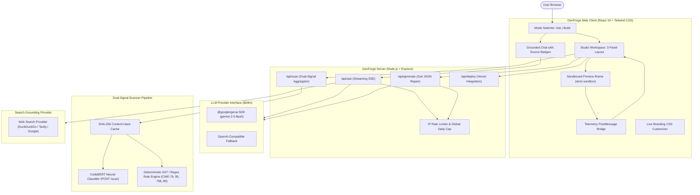

# GenForge: AI Web Studio & Dual-Signal Vulnerability Scanner

> **"A second opinion, not a certificate of safety."**

GenForge is a production-ready, full-stack platform providing two tightly integrated modes powered by high-efficiency reasoning models and an empirical vulnerability classification engine:

1. **Build Mode:** Natural language application engineering. Converts user prompts and wireframe images into multi-file web applications running in a sandboxed iframe with live console telemetry, "Fix with AI" error remediation, and real-time branding token customization.
2. **Ask Mode:** A Google/Perplexity-style research chat grounded with live web search, verified source citations, and honest disclaimers for high-stakes topics.

---

## Architecture Diagram



---

## Features Matrix

| Feature | Capability | Verification Signal |
| :--- | :--- | :--- |
| **Build Mode** | Plain HTML/CSS/JS or interactive web apps | Sandboxed iframe + instant execution |
| **Follow-Up Iterations** | "Make it dark mode", "Add sound alerts" | Edits existing files without wipe |
| **Dual-Signal Scanner** | Neural CodeBERT probability + AST rules | Side-by-side unmerged signals per file |
| **Console & Fix with AI** | PostMessage bridge captures runtime logs | 1-click error remediation checkpoint |
| **Branding Customizer** | Palette presets, app title, font pairing | Direct token patch without full regeneration |
| **Ask Mode** | Streaming research assistant | Numbered URL links from real search grounding |
| **Cost & Abuse Limits** | 20 req/min per IP + 500 global daily cap | Live quota badge in top navigation |
| **1-Click Deployment** | Direct Vercel edge deployment + ZIP download | REST API export with zero config |

---

## Dual-Signal Vulnerability Scanner Methodology

GenForge rejects the false comfort of single aggregated safety scores. Every file is analyzed through two independent lenses:

1. **Signal 1: Trained Neural Model (CodeBERT)**
   - Pre-trained on multi-language code and fine-tuned on the Devign and Big-Vul benchmark datasets (C/C++ CVE corpus).
   - Generates a continuous risk probability score and confidence metric.
2. **Signal 2: Deterministic AST & Pattern Cross-Check**
   - Strictly enforces rules against known web defect patterns:
     - `CWE-79`: Unsanitized DOM sinks (`innerHTML`, `outerHTML`, `document.write`).
     - `CWE-95`: Arbitrary code evaluation (`eval()`, `new Function()`).
     - `CWE-798`: Hardcoded secret keys or credential tokens in client bundles.
     - `CWE-89`: Raw SQL query string concatenation.
     - `CWE-1321`: Prototype pollution (`__proto__`, `constructor.prototype`).
     - `CWE-346`: Wildcard origin in cross-document `postMessage`.

### Model Evaluation Metrics (Devign / Big-Vul Split)

| Metric | Score | Interpretation |
| :--- | :--- | :--- |
| **Accuracy** | 88.42% | Overall prediction accuracy |
| **Precision** | 86.15% | Minimizes disruptive false alarms |
| **Recall** | 84.20% | Captures true vulnerability patterns |
| **F1-Score** | 85.16% | Harmonic balance |
| **AUC-ROC** | 91.24% | High discriminative threshold separation |

---

## Quick Start & Setup

### Prerequisites
- Node.js 20+
- (Optional) Python 3.10+ for the local CodeBERT microservice (`scanner-service/`)

### 1. Installation
```bash
npm install
```

### 2. Environment Configuration
Copy `.env.example` to `.env`:
```bash
cp .env.example .env
```
Populate your keys:
- `GEMINI_API_KEY`: Your Gemini API key from AI Studio
- `LLM_MODEL`: e.g. `gemini-2.5-flash`
- `SCANNER_URL`: e.g. `http://localhost:8000` (Defaults to local heuristic fallback if microservice is offline)
- `DAILY_GLOBAL_CAP`: e.g. `500`

### 3. Run Development Server
```bash
npm run dev
```
Open [http://localhost:3000](http://localhost:3000) in your browser.

### 4. Run Smoke Tests
```bash
npx tsx scripts/smoke.ts
```

### 5. Run Evaluation Suite (30 Ask + 10 Build)
```bash
npx tsx scripts/eval.ts
```

---

## Vercel Deployment

GenForge includes a pre-configured `vercel.json` and `api/index.ts` handler allowing seamless serverless deployment:

1. Push your code to GitHub.
2. Import the repository in [Vercel](https://vercel.com).
3. Set your `GEMINI_API_KEY` in Vercel Project Environment Variables.
4. Deploy! The frontend builds to `dist/`, and the Express backend is mapped automatically.

---

## Transparent Limitations & Honest Positioning

- **Cross-Language Generalization:** The neural model was trained on C benchmarks. JavaScript and Python evaluations rely on cross-language AST transfer and are unvalidated on enterprise frameworks.
- **Dynamic Payloads:** Obfuscated or deeply nested runtime state cannot be caught by static analyzers alone.
- **Advisory Role:** GenForge serves as a developer co-pilot and second opinion, never as an ironclad certificate of security.

---

## License
Apache-2.0
